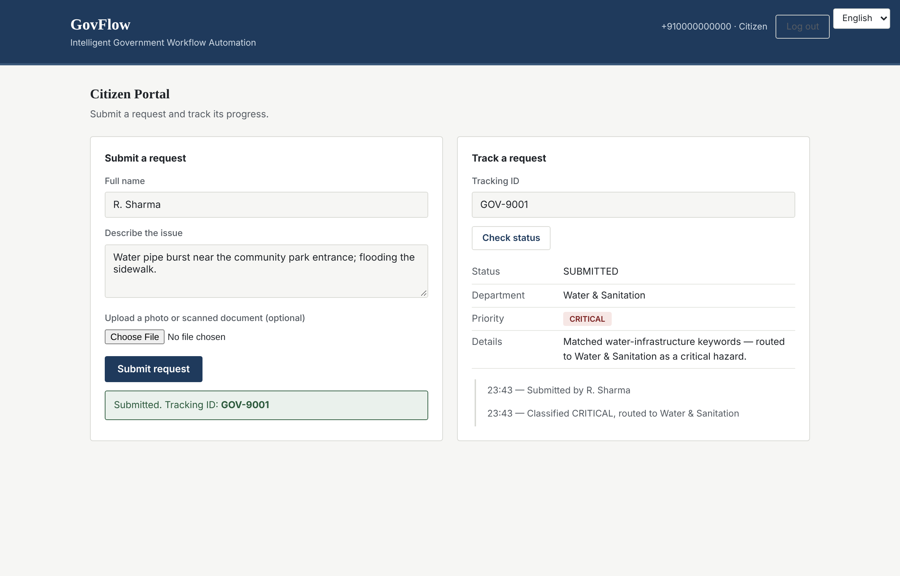
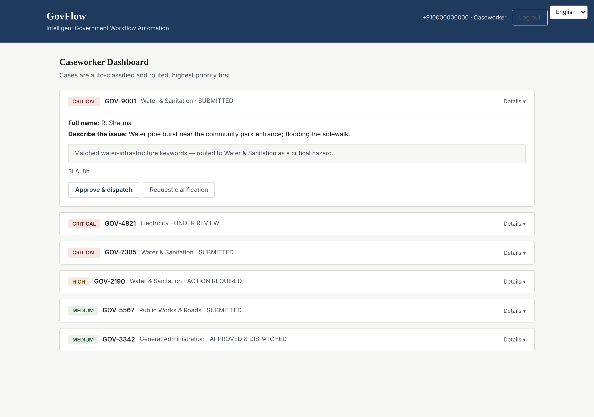
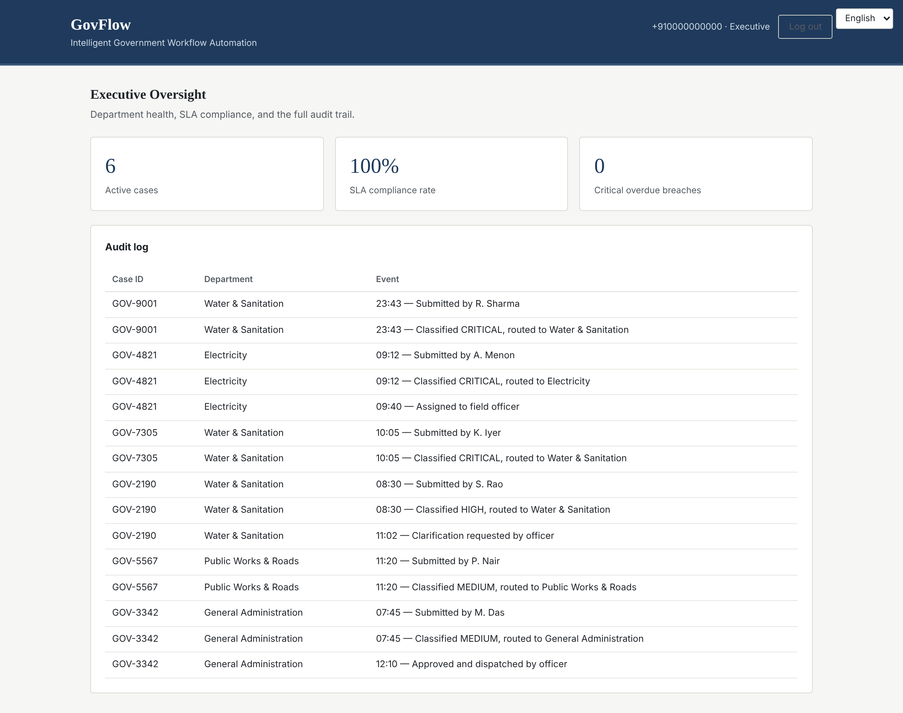
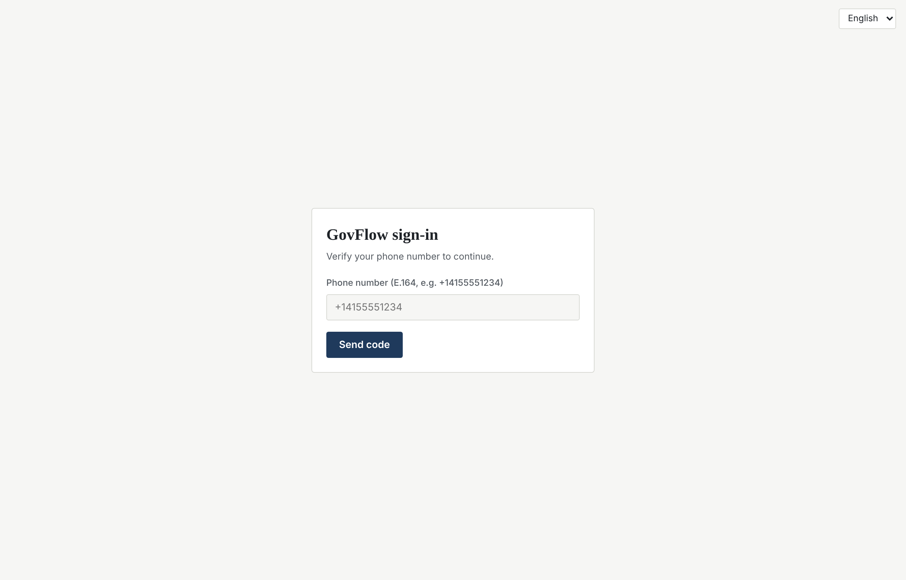

# GovFlow — Intelligent Government Workflow Automation

> 🏆 **Second Prize** — built in a **six-hour hackathon** for problem statement **SA-01: Intelligent Government Workflow Automation**.

Government departments often handle applications, files and approvals through fragmented workflows, causing delays and repeated manual verification. GovFlow gives each type of user one clear place to work: citizens submit and track requests, caseworkers work an auto-routed priority queue, and senior officials watch SLA health and the full audit trail.

> **Hackathon prototype.** It was designed, built and demoed in six hours. It is a working proof of concept, not production software. Please read [Known limitations](#known-limitations) before using it for anything real.

## Screenshots

| Citizen Portal | Caseworker Dashboard |
|---|---|
|  |  |

**Executive Oversight**



<details>
<summary>Sign-in screen</summary>


</details>

*Screenshots show sample data and a stubbed OTP backend; no real phone numbers or accounts were used.*

## The three portals

| User | Portal | What they do |
|---|---|---|
| Citizen | Citizen Portal | Submit a request (optionally with a photo or scan), get a tracking ID, see plain-language status and a timeline |
| Official / caseworker | Caseworker Dashboard | Work an auto-classified, priority-sorted queue; approve or request clarification |
| Higher official | Executive Oversight | See active load, SLA compliance, overdue breaches and the full audit log |

After sign-in, each person sees only the dashboard for their role.

## Features

- **Phone OTP login** via Twilio Verify (SMS). Credentials stay on the server and never reach the browser.
- **Document intake with OCR** using Tesseract.js, running in the browser (free, no API key).
- **Rule-based classification and routing** into departments (Water & Sanitation, Electricity, Public Works & Roads, Public Safety, General Administration), with a priority level and a human-readable reasoning trail.
- **Audit log** of who did what and when, for every case.
- **Shared live data** across all three portals, stored in Cloudflare KV.
- **Multilingual UI:** English, हिंदी (Hindi), தமிழ் (Tamil).

## How classification works (it is not ML)

Case classification is **rule-based, not machine-learning-based**. There is no trained model, no LLM call and no external AI service. The `classify()` function in `public/index.html` lowercases the citizen's description and runs it through a fixed, ordered list of keyword regular expressions (for example `water|leak|pipe|drain|sewage` → Water & Sanitation). The first matching rule decides the department, and a second set of keywords (such as `burst|flood|contaminat`) escalates priority to CRITICAL. Anything unmatched goes to General Administration for manual triage.

Why this approach: it is deterministic, instantly explainable (every case stores the rule that fired as its `reasoning`), and needs no training data or API cost. The trade-offs are that it only recognises English keywords and misses anything phrased unexpectedly. See the [Roadmap](#roadmap) for the ML/LLM direction.

## Architecture

```
Browser (public/index.html)
   │  fetch /api/...
   ▼
Cloudflare Pages Functions (functions/api)
   ├── send-otp.js    ──► Twilio Verify (send code)
   ├── verify-otp.js  ──► Twilio Verify (check code)
   └── cases.js       ──► Cloudflare KV (CASES_KV)
```

Flow: citizen submits → (optional) OCR in browser → rules pick department and priority and record their reasoning → case saved with an audit entry → caseworker acts → status and audit log update for everyone.

## Project structure

```
govflow/
├── public/index.html         # entire frontend (HTML, CSS, JS, translations)
├── functions/api/
│   ├── send-otp.js           # POST /api/send-otp
│   ├── verify-otp.js         # POST /api/verify-otp
│   └── cases.js              # GET/POST/PATCH /api/cases
├── docs/screenshots/         # README images
├── wrangler.toml             # Cloudflare config + KV binding
├── package.json              # dev/deploy scripts
├── .dev.vars.example         # template for local secrets
└── .gitignore
```

## Setup

### Prerequisites
- Node.js 18+
- A free [Cloudflare account](https://dash.cloudflare.com/sign-up)
- A [Twilio](https://www.twilio.com/) account with a **Verify Service** (you need its Service SID, plus your Account SID and Auth Token)

### 1. Install
```bash
git clone <your-repo-url>
cd govflow
npm install
npx wrangler login
```

### 2. Create the KV namespace
```bash
npx wrangler kv namespace create CASES_KV
```
Copy the printed `id` into `wrangler.toml`, replacing `PASTE_YOUR_KV_NAMESPACE_ID_HERE`.

### 3. Configure secrets for local development
```bash
cp .dev.vars.example .dev.vars
```
Edit `.dev.vars` and fill in:

| Variable | Where to find it |
|---|---|
| `TWILIO_ACCOUNT_SID` | Twilio Console dashboard |
| `TWILIO_AUTH_TOKEN` | Twilio Console dashboard |
| `TWILIO_VERIFY_SERVICE_SID` | Twilio Console → Verify → Services |

`.dev.vars` is git-ignored. **Never commit real values.**

> On a Twilio trial account, SMS can only be sent to phone numbers you have verified in the console.

### 4. Run locally
```bash
npm run dev
```
Open the printed `localhost` URL and sign in with a phone number in E.164 format (e.g. `+14155551234`).

## Deployment (Cloudflare Pages)

Set the secrets **before** deploying. Each command prompts for the value and stores it encrypted:

```bash
npx wrangler pages project create govflow      # first time only
npx wrangler pages secret put TWILIO_ACCOUNT_SID --project-name govflow
npx wrangler pages secret put TWILIO_AUTH_TOKEN --project-name govflow
npx wrangler pages secret put TWILIO_VERIFY_SERVICE_SID --project-name govflow
npm run deploy
```

Then, in the Cloudflare dashboard, open the Pages project → **Settings → Functions → KV namespace bindings** and confirm `CASES_KV` is bound to the namespace you created (the binding in `wrangler.toml` normally handles this).

## API reference

| Method | Endpoint | Body / query | Returns |
|---|---|---|---|
| POST | `/api/send-otp` | `{ "to": "+14155551234" }` | `{ "status": "pending" }` |
| POST | `/api/verify-otp` | `{ "to": "...", "code": "123456" }` | `{ "approved": true }` |
| GET | `/api/cases` | none | `{ "cases": [...] }` |
| POST | `/api/cases` | `{ citizen, department, issue, priority, reasoning, slaHours, audit }` | `{ "case": {...} }` |
| PATCH | `/api/cases?id=GOV-1234` | `{ status?, audit_append? }` | `{ "case": {...} }` |

## Known limitations

Deliberate hackathon-scope choices, listed so nobody mistakes them for finished security:

1. **Roles are self-selected after OTP.** The UI hides other dashboards, but nothing server-side enforces roles. Production needs a mapping of verified phone numbers to roles.
2. **`/api/cases` is unauthenticated.** Anyone who knows the URL can read or modify cases. Production needs signed session tokens checked on every call.
3. **No rate limiting** on OTP requests beyond Twilio's own limits.
4. **Classification is keyword-based** (see above) and recognises English keywords only.
5. **OCR accuracy:** Tesseract.js handles printed text well but handwriting poorly, especially Hindi and Tamil scripts.
6. **Uploaded images are not stored**, only the extracted text.
7. **SLA hours are a static value** set at submission; there is no background timer yet.

## Roadmap

- Server-side role lookup and signed session tokens
- ML/LLM-assisted classification and field extraction behind a `/api/classify` function
- RAG over department policy documents for explainable status messages
- Image storage (Cloudflare R2) so caseworkers can view the original document
- Background SLA monitor with escalation and SMS status notifications
- Duplicate and related-case detection

## License

No license has been applied yet. Until one is added, all rights are reserved by the authors.
